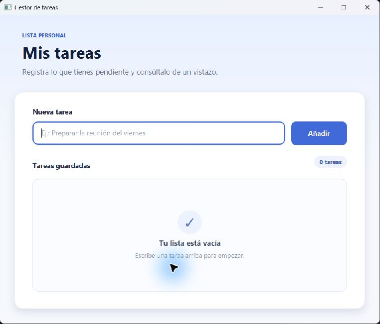
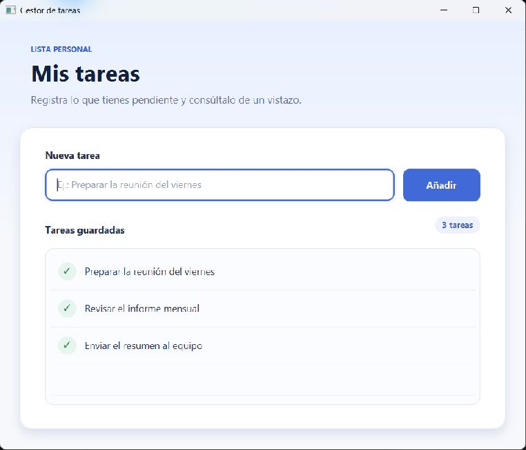
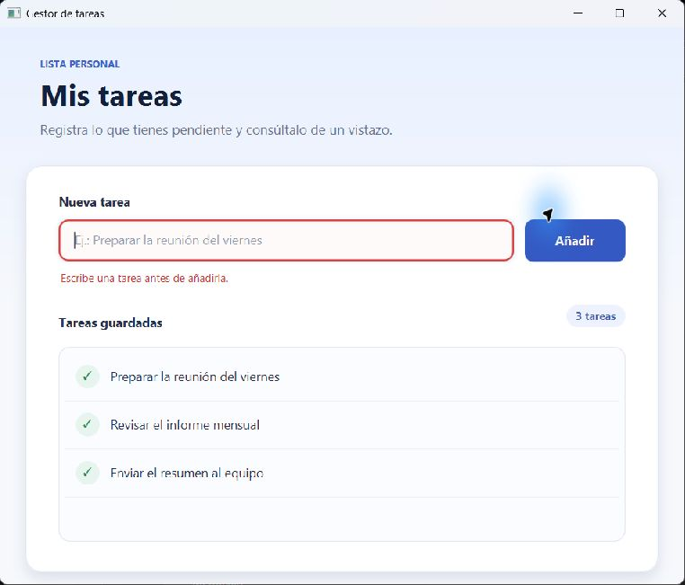

# Gestor de tareas con JavaFX

Aplicación de escritorio sencilla para registrar textos o tareas y consultarlos durante la sesión actual. La interfaz está construida íntegramente con JavaFX y no necesita FXML.

## Capturas de pantalla

| Inicio | Tareas registradas | Validación de entrada vacía |
|---|---|---|
|  |  |  |

Las capturas muestran la aplicación JavaFX en ejecución en Windows.

## Requisitos

- JDK 21 o posterior (`java` y `javac` disponibles).
- Conexión a Internet la primera vez, para que Maven descargue JavaFX y JUnit.
- En macOS/Linux: `sh`, `tar`, `awk`, `curl` o `wget`, y `sha512sum` o `shasum`.

No es necesario instalar Maven: los scripts `mvnw.cmd` y `mvnw` preparan una copia local cuya suma SHA-512 está fijada en el propio script.

## Ejecutar en Windows

Desde PowerShell, en la raíz del proyecto:

```powershell
.\mvnw.cmd clean javafx:run
```

## Ejecutar en macOS o Linux

```bash
chmod +x mvnw
./mvnw clean javafx:run
```

## Pruebas

```powershell
.\mvnw.cmd clean test
```

En macOS o Linux:

```bash
./mvnw clean test
```

Las pruebas unitarias comprueban el alta, el recorte de espacios, el orden de inserción, el rechazo de entradas vacías y la protección de la colección.

## Cobertura de las historias de usuario

| Historia | Implementación |
|---|---|
| HU-01 | Título de ventana «Gestor de tareas» y cabecera visible «Mis tareas». |
| HU-02 | Campo descriptivo, botón «Añadir» y alta inmediata en la lista. |
| HU-03 | `ListView` con todos los elementos de la sesión y contador actualizado. |
| HU-04 | Tras guardar, el campo se limpia y recupera el foco; también se admite Enter. |
| HU-05 | Se rechazan valores nulos, vacíos o con solo espacios y se muestra un mensaje junto al campo. |

## Estructura

```text
src/
├── main/
│   ├── java/com/ejemplo/gestortareas/
│   │   ├── Main.java
│   │   ├── GestorTareasApp.java
│   │   └── RegistroService.java
│   └── resources/com/ejemplo/gestortareas/styles.css
└── test/java/com/ejemplo/gestortareas/RegistroServiceTest.java
```

Los datos se mantienen en memoria mientras la aplicación está abierta. La persistencia entre ejecuciones no forma parte de las historias solicitadas.
